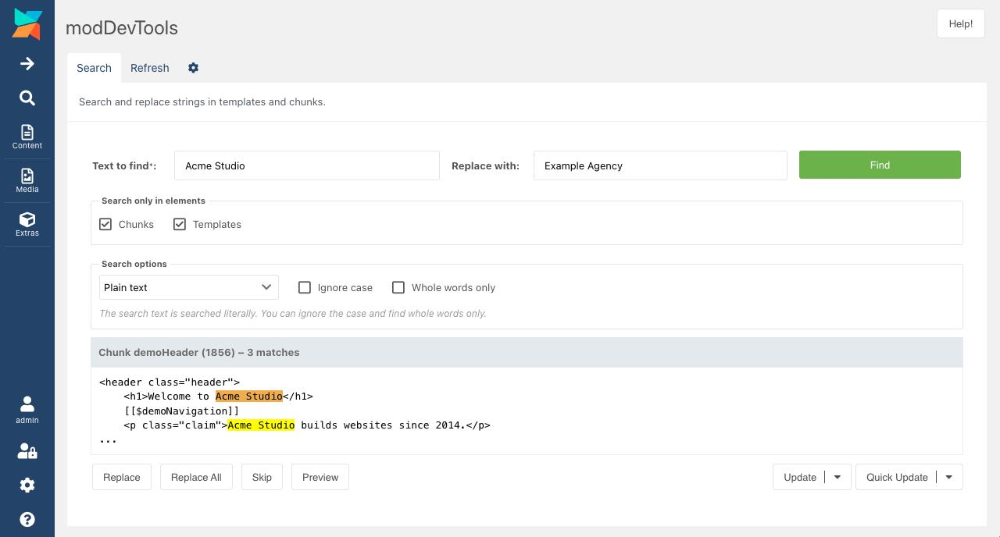
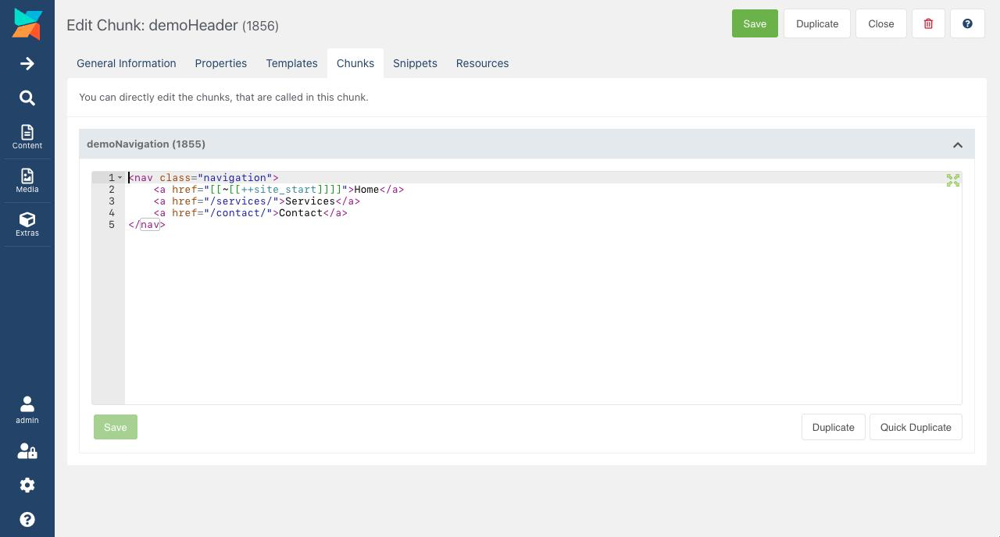
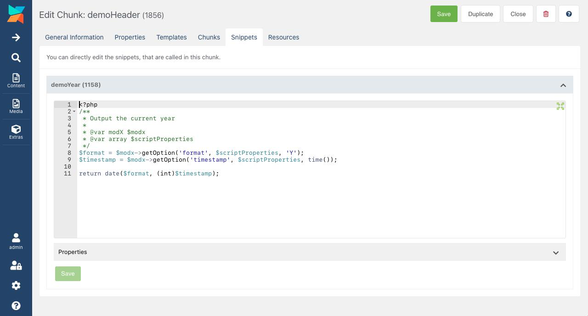
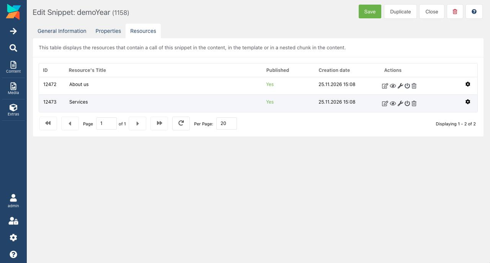
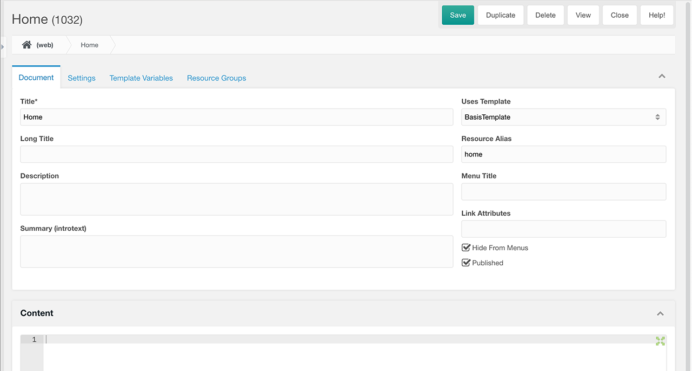

## Introduction

This MODX Extra adds some nice development features to the MODX manager.

## Search and replace

The Extras menu contains a new entry modDevTools, which opens a separate manager
page. It allows you to search and replace text in the contents of
chunks and templates.

Enter the text you want to search for and click the `Search` button. Below the
search field there are checkboxes to limit the search to specific elements
(chunks and templates). Static elements are searched in the current content of
their file, even if it was changed outside of MODX, and replacements are written
to that file.

### Search options

| Option                | Description                                                                                                               |
|-----------------------|---------------------------------------------------------------------------------------------------------------------------|
| `Plain text`          | The search text is searched literally. This is the default.                                                               |
| `Wildcards`           | `*` matches any text within a line and `?` any single character, e.g. `tpl*Row` or `Pre?s`.                               |
| `Regular expression`  | The search text is a PCRE regular expression without delimiters, e.g. ``&limit=`(\d+)` ``. `^` and `$` match at line ends. |
| `Ignore case`         | Plain text only: ignores upper and lower case. Without this option the search is case-sensitive.                          |
| `Whole words only`    | Plain text only: finds the search text only, if it isn't part of a longer word.                                           |

A wildcard `*` matches as little text as possible. Put some text after it, since
a trailing `*` matches nothing: `tpl*` only finds `tpl`.

The wildcard and regular expression searches are always case-sensitive (a regular
expression can start with `(?i)` to ignore the case and use `\b` for word
boundaries).

In the regular expression mode the replacement can contain the matched groups as
`$1`, `${1}` or `\1` (`$0` is the whole match) and `\n` or `\t` for a new line
or a tab. In the other modes the replacement is used literally. A search text
that can match an empty text (e.g. `a*`) or an invalid regular expression is
rejected.

### Replace

After a successful search, the code of all found elements is displayed, with the
search text highlighted and the number of matches in the title. For each found
element there are four buttons below the code block: `Replace`, `Replace all`,
`Skip` and `Preview`.

The `Replace` button replaces the match at the position where the cursor is
located (dark highlighting) with the replacement and moves the cursor to the
next match. The `Skip` button only moves the cursor to the next match, without
changing the element. The `Replace All` button replaces all matches in the code
of the current element.

The `Preview` button opens a window with a list of all matches (up to 500) of
the element, showing the text that is removed (red) and the replacement
(green) in its line. All matches are selected at first. Untick the matches you
don't want to change and click `Replace selected`. If the element was changed
after the preview was created, nothing is replaced and you have to search again.

There are also two other buttons on the right side below the code element:
`Update` and `Quick Update`. When you click the `Update` button, the element's edit
page opens. Clicking the `Quick Update` button opens a modal window where you can
quickly edit the element.

## Refresh the element links

The additional tabs on the element pages are filled from a table of the links
between chunks, snippets, templates and resources. The links are updated, when a
chunk, template or resource is saved, and they are created for all elements
during the installation of the package.

If elements were changed in another way, e.g. in static files, by an import or
directly in the database, use the `Refresh` tab of the custom manager page. Select
whether the links of chunks, templates and resources should be recreated and
click the `Refresh` button.

## Edit linked elements

The editing page of chunks, snippets and templates contains some additional
tabs. These tabs allow you to edit the content of linked (used) elements on the
current page. The following element pages contain the tabs listed below.

### Chunk Page
- `Templates Tab` - The code of templates in which the currently edited chunk is called. If you have installed Ace, the chunk is highlighted in the template code.
- `Chunks Tab` - The code of chunks that are called in the currently edited chunk. Snippet parameters specified in the call and default snippet parameters related to chunks also appear here.
- `Snippets Tab` - The code of snippets that are called in the currently edited chunk. Below the snippet code you can expand the snippet properties with default values and descriptions.
- `Resources Tab` - List of resources that are included in the template or whose content is called in some way in this chunk. You can go to the edited resource, open it in the browser, quickly change the template or publishing status or move it to the trash.

### Template Page
- `Chunks Tab` - The code of chunks that are called in the currently edited template.
- `Snippets Tab` - The code of snippets that are called in the currently edited template.
- `Resources Tab` - A list of resources with the currently edited template.

### Snippet Page
- `Resources Tab` - A list of resources where the currently edited snippet is called.

#### Example Chunks Tab

#### Example Snippets Tab

#### Example Resources Tab

## Template edit link

On the Edit Resources page, an edit icon next to the template field opens the
edit page of the selected template.

## Linked Breadcrumb Path

On the Edit Resources page, a linked breadcrumb path is inserted below the page
title. You can click any section of this breadcrumb path to edit the clicked
resource. There are two system settings for changing parts of this breadcrumb
path. This breadcrumb path is not shown in MODX 3.x, since this version has its
own breadcrumb path.

## User permissions

modDevTools uses standard user access permissions:

| Permission                       | Description                                                                                                          |
|----------------------------------|----------------------------------------------------------------------------------------------------------------------|
| view_chunk & view_template       | To open the custom manager page and search in chunks and templates.                                                  |
| save_chunk                       | For changing strings in chunks in the `Chunks Tab` and for string replacement in chunks on the search page.          |
| save_snippet                     | For changing strings in snippets in the `Snippets Tab`.                                                              |
| save_template                    | For changing strings in templates in the `Templates Tab` and for string replacement in templates on the search page. |
| view_chunk                       | To display the `Chunks Tab`.                                                                                         |
| view_template                    | To display the `Templates Tab`.                                                                                      |
| view_snippet                     | To display the `Snippets Tab`.                                                                                       |
| view_document                    | To display the `Resources Tab`.                                                                                      |
| edit_document                    | To display an edit icon in the table on the `Resources Tab`.                                                         |
| save_document                    | To change the template of a resource in the table on the `Resources Tab`.                                            |
| publish_document                 | To change the publication status in the table on the `Resources Tab`.                                                |
| delete_document                  | To move a resource to the trash in the table on the `Resources Tab`.                                                 |
| edit_template                    | To display the template edit icon on the Edit Resources page.                                                        |
| system_perform_maintenance_tasks | To refresh the element links in the `Refresh` tab.                                                                   |
| settings or moddevtools_settings | To display the system settings tab of the custom manager page.                                                       |

**Attention:** resource groups are currently not supported, i.e. if a resource
group is hidden from site managers in the mgr context, they can still see its
resources in the resource list.

## System Settings

modDevTools uses the following system settings in the `moddevtools` namespace
and shows them in an additional tab on the custom manager page:

| Key                                 | Name                    | Description                                  | Default |
|-------------------------------------|-------------------------|----------------------------------------------|---------|
| moddevtools.breadcrumb_limit        | Breadcrumb Limit        | Limit of displayed breadcrumb entries.       | 3       |
| moddevtools.debug                   | Debug                   | Log debug information in the MODX error log. | No      |
| moddevtools.show_breadcrumb_context | Show Breadcrumb Context | Show the context key in the breadcrumb path. | No      |
